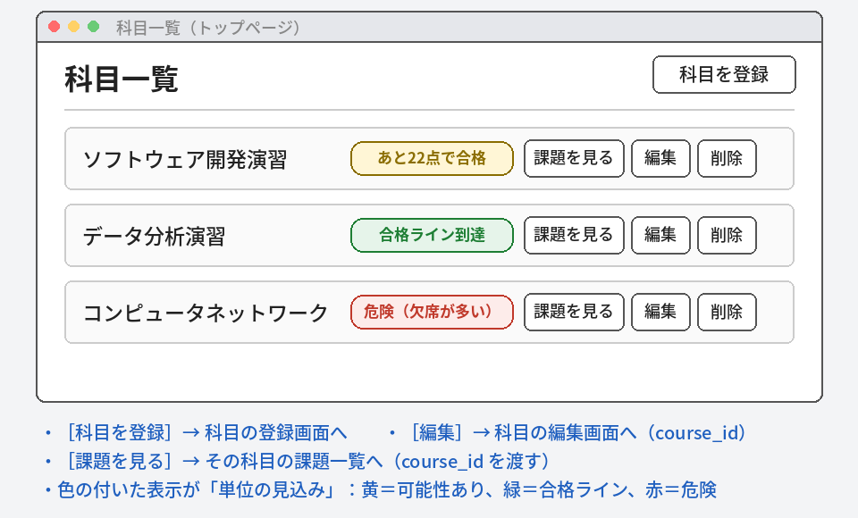
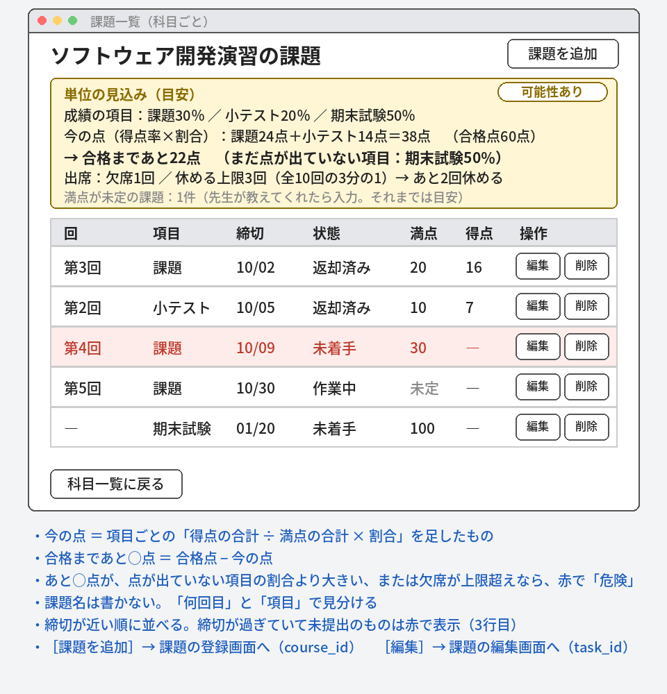
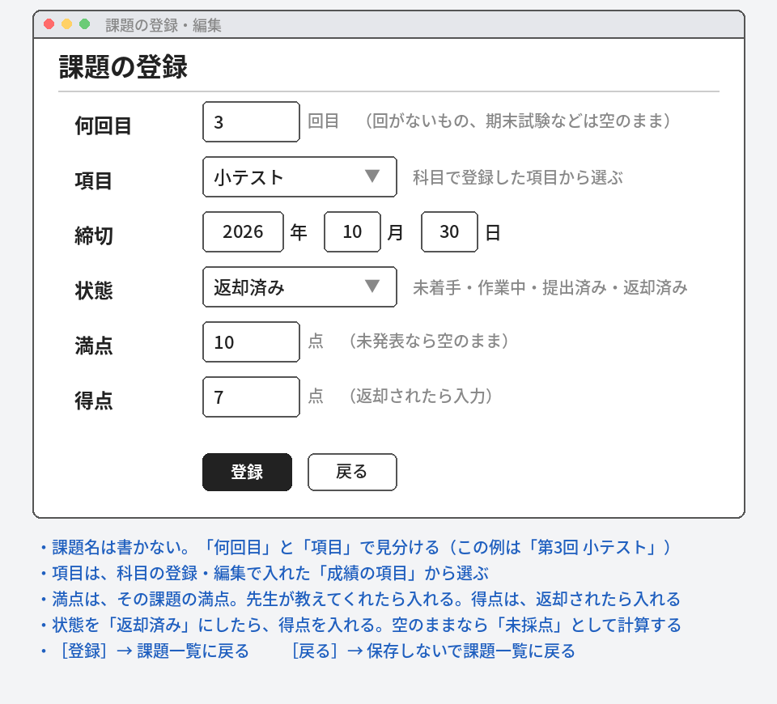
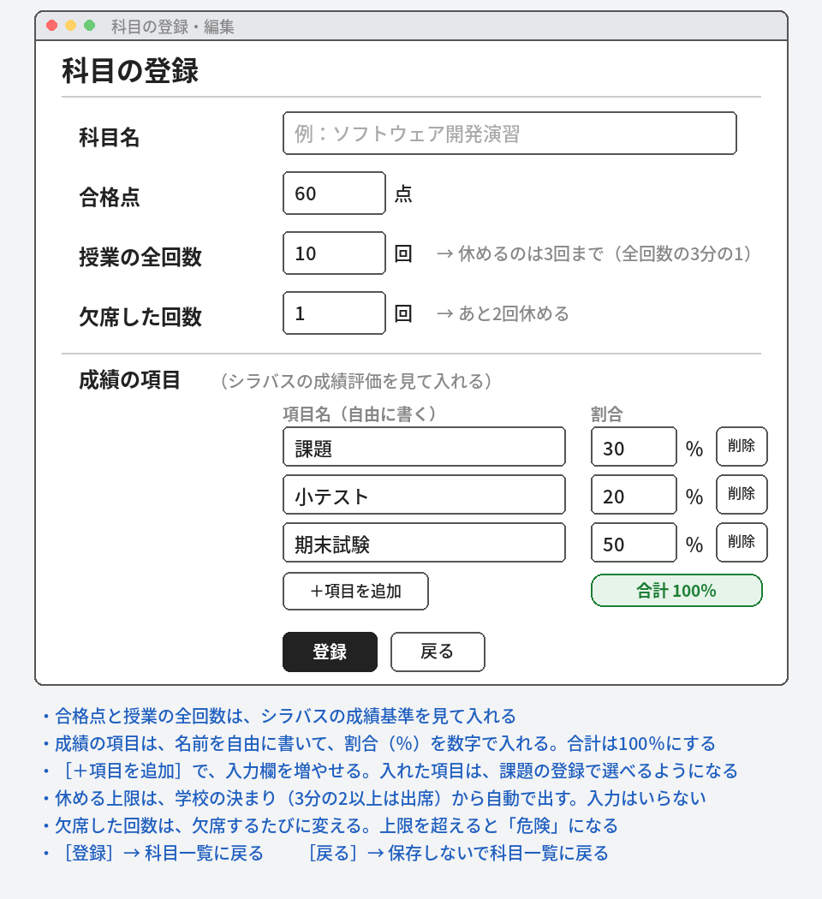
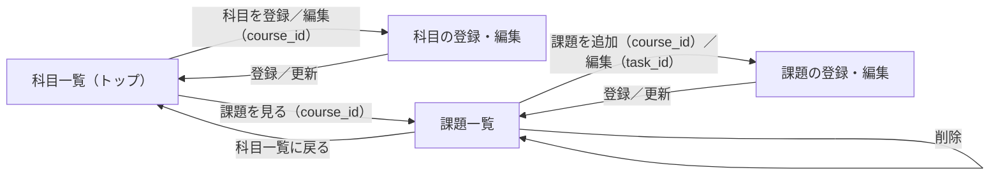
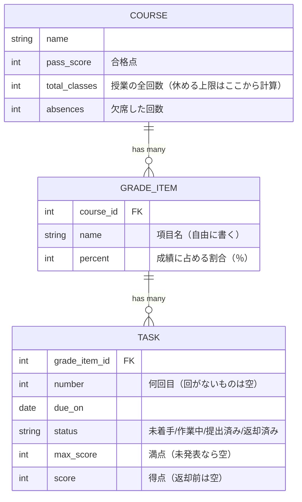

# 基本設計書：課題締切管理アプリ

- チーム番号：7
- メンバー：中山 正義, 坂 倭

## 課題

- 選んだ課題：大学の課題（レポートなど）の締切を見落としてしまう。
- 誰の課題か：履修科目が多いけど楽して単位が欲しい学生（ペルソナ：なるべく楽して単位が欲しい僕たち）
- なぜこの課題を選んだか：効率的に単位をとりたいと考えたから
- 元になった自治体課題：なし（方法Aで選んだ）

## 0. 考えを整理する3つの問い

- 開発目的：課題の締切を科目ごとにまとめて、提出し忘れを防ぎたい。あわせて、出席と課題の点数から、単位が取れそうかを確認できるようにする。
- 想定ユーザ：学生
- 機能：
  - ①科目の登録・編集・削除（成績の項目の登録を含む）
  - ②課題・小テスト・試験の登録・編集・削除
  - ③状態の変更（返却済みを含む）
  - ④締切順の一覧表示
  - ⑤締切超過の赤色表示
  - ⑥返却された点数（得点・満点）の記録
  - ⑦単位の見込みの表示（成績の割合・得点・欠席回数から計算）
- 一般的なToDoアプリとの違い：ToDoアプリは課題を1つずつ管理するだけ。このアプリは、科目ごとに成績の割合・欠席回数・課題の点数をまとめて、「単位が取れそうか」まで分かる。

## 1. ユーザーストーリー

まず作るもの

- ストーリー1：【学生】として、提出し忘れを防ぐために、科目ごとに課題を登録して締切を残したい。
- ストーリー2：【学生】として、次に何をやるか決めるために、締切が近い順に課題を一覧で見たい。締切が過ぎたものは赤で目立たせたい。
- ストーリー3：【学生】として、進み具合が分かるように、課題の状態（未着手・作業中・提出済み・返却済み）を変えたい。
- ストーリー4：【学生】として、科目や課題が増えたり不要になったりしたときのために、科目と課題を登録・削除したい。

このアプリの特徴（単位の見込み）

- ストーリー5：【学生】として、単位が取れるか早めに知るために、科目の合格点・授業の全回数・成績の項目（名前と割合）と、課題ごとの満点（分かっていれば）を登録したい。
- ストーリー6：【学生】として、見込みを最新にするために、課題や小テストが返却されたら、先生が教えてくれた満点と得点を入れ、欠席した回数も更新したい。
- ストーリー7：【学生】として、どの科目が危ないか分かるように、科目ごとに「あと何点で合格か」と、あと何回休めるかを見たい。

## 2. 画面イメージ（ワイヤーフレーム）

### 2-1. 科目一覧（トップページ）　ストーリー4・7

### 2-2. 課題一覧（科目ごと）　ストーリー1・2・3・4・7

### 2-3. 課題の登録・編集　ストーリー1・3・5・6

### 2-4. 科目の登録・編集　ストーリー4・5・6

### 2-5. ストーリーと画面の対応

●＝その画面で実現する。ストーリー1〜7は、どれも、どれかの画面に●がある。

| ストーリー | 科目一覧 | 科目の登録・編集 | 課題一覧 | 課題の登録・編集 |
|---|:---:|:---:|:---:|:---:|
| 1　課題を登録して締切を残す |  |  | ● | ● |
| 2　締切が近い順に見る（過ぎたら赤） |  |  | ● |  |
| 3　状態を変える（返却済みまで） |  |  | ● | ● |
| 4　科目・課題を登録・削除する | ● | ● | ● |  |
| 5　合格点・成績の項目・満点を登録する |  | ● |  | ● |
| 6　返却された点数・欠席回数を更新する |  | ● |  | ● |
| 7　科目ごとに「あと何点で合格か」を見る | ● |  | ● |  |

## 3. ページ遷移図

- 四角＝画面。矢印＝押したときの移動。矢印の上の文字が、押すボタン。
- `（ ）` の中は、次の画面へ渡す値（`course_id`、`task_id`）。

## 4. データモデル（ER図）

- 表は3つ。科目（Course）、成績の項目（GradeItem）、課題（Task）。
- 科目と成績の項目は「1対多」。1つの科目に、項目（課題30％、小テスト20％など）がたくさんつく。項目の表に `course_id`（科目の番号）を入れる。
- 成績の項目と課題も「1対多」。1つの項目に、課題がたくさんつく。課題の表に `grade_item_id`（項目の番号）を入れる。番号を持つのは、どちらも「多」の側。
- 項目名は自由に書ける。割合は数字で入れて、DBに保存する。課題を登録するときは、その科目の項目を選ぶ。
- 科目の登録画面で、項目の入力欄を並べて、科目と一緒に保存する（Railsの `accepts_nested_attributes_for` を使う）。項目の割合の合計は、100％にする。
- コードでは、Course に `has_many :grade_items, dependent: :destroy`、GradeItem に `belongs_to :course` と `has_many :tasks, dependent: :destroy`、Task に `belongs_to :grade_item` と書く。科目の課題は、`has_many :tasks, through: :grade_items` で取れる。
- `dependent: :destroy` を付けるので、科目を消すと、項目も課題も一緒に消える。項目を消すと、その項目の課題も消える。持ち主がいなくなった課題が残るのを防ぐため。
- 課題名は持たない。「何回目」（number）と項目で見分ける。画面には「第3回 課題」「第2回 小テスト」のように出す。
- 満点と得点は、先生が返却のときに教えてくれる場合もあるので、どちらも空のままで登録できるようにする。状態を「返却済み」にしたら、得点は必ず入れる。
- 状態（status）は、学生が「未着手→作業中→提出済み→返却済み」と自分で変える値なので、保存しておく項目（カラム）にする。
- 「あと何点で合格か」は、保存せず、そのたびに計算して出す。同じ情報を2か所に持つと、ずれるため。休める回数の上限も、保存せず、全回数から計算する。学校の決まりが「授業の3分の2以上は出席」なので、上限は全回数の3分の1（切り捨て）。

## 4-2. 単位の見込みの計算（目安）

| 名前 | 意味 | 求め方 |
|---|---|---|
| 項目の得点率 | その項目で、いま何割取れているか | 返却済みの課題の（得点の合計 ÷ 満点の合計） |
| 今の点 | いまの得点率のままなら、何点か | 項目ごとに「得点率 × 割合」を出して足す（返却済みがない項目は0点） |
| 合格まであと | 合格のために、これから取る必要がある点 | 合格点 − 今の点（0より小さければ0） |
| まだ点が出ていない項目の割合 | 返却済みの課題が1つもない項目の割合の合計 | その項目の `percent` の合計 |
| 満点が未定の件数 | 先生がまだ満点を教えてくれていない課題の数 | 満点が空の課題の件数 |
| 休める上限 | 欠席してよい回数の上限 | 全回数 ÷ 3 の切り捨て |
| あと休める回数 | これから休める回数 | 休める上限 − 欠席した回数 |

点の判定は3つ。

- **合格ライン到達**：「合格まであと」が0
- **あと○点で合格**：「合格まであと」が、「まだ点が出ていない項目の割合」以下（まだ可能性がある）
- **危険（届かない）**：「合格まであと」が、「まだ点が出ていない項目の割合」より大きい（点が出ていない項目が全部満点でも届かない）

出席の判定は2つ。

- **OK**：欠席した回数が、休める上限以下
- **危険（欠席が多い）**：欠席した回数が、休める上限を超えた（もう3分の2以上は出席できない）

科目の見込みは、点と出席を合わせて決める。どちらかが危険なら、その科目は「危険」と表示する。

計算例：合格点60、成績の項目が「課題30％、小テスト20％、期末試験50％」、全10回で欠席1回
- 課題：返却済みは第3回の16/20点。得点率80％なので、30 × 0.8 ＝ 24点
- 小テスト：返却済みは第2回の7/10点。得点率70％なので、20 × 0.7 ＝ 14点
- 期末試験：まだ返却済みがないので、0点（割合50％が、これから取れる分）
- 今の点は 24 + 14 ＝ 38点。合格まであと 60 − 38 ＝ 22点。50％まで取れるので、可能性あり。
- 休める上限は 10 ÷ 3 ＝ 3回（切り捨て）。欠席1回なので、あと2回休める。
- 点も出席も大丈夫なので、「あと22点で合格」と表示する。満点が未定の課題が1件あるので、見込みは目安として表示する。

これは入力した数字からの目安で、満点が未定のものがある間や、課題の数が途中で増える間は、ずれることがある。実際の単位は、シラバスの基準と先生の判断で決まる。出席の決まり（3分の2以上は出席）は扱う。再試験や特別な扱いなど、そのほかの条件は扱わない。

## 5. 開発着手の許可基準に対する自己チェック

- [ ] 課題の具体性：身近な実在のペインに基づいているか？
- [ ] 連動性：ユーザーストーリーと画面・データモデルが破綻なく繋がっているか？
- [ ] ボリュームの妥当性：第14回までに2名で作りきれる規模感か？
